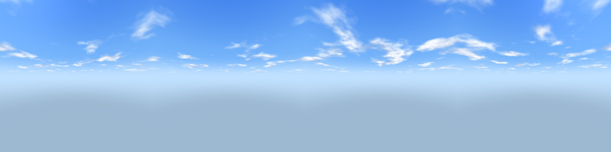
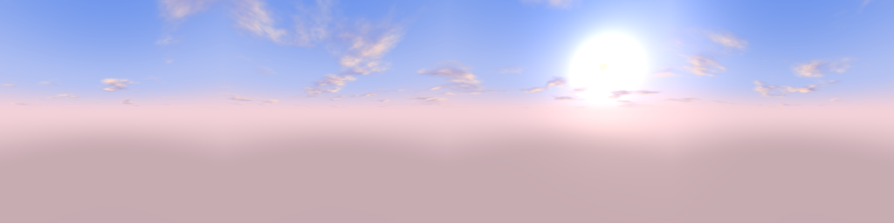
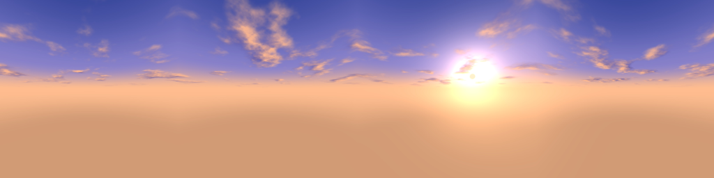
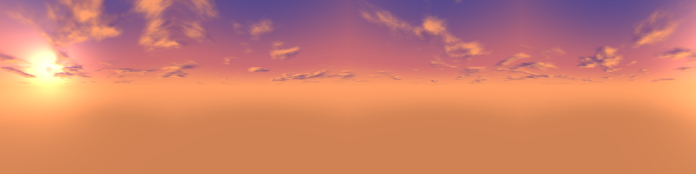
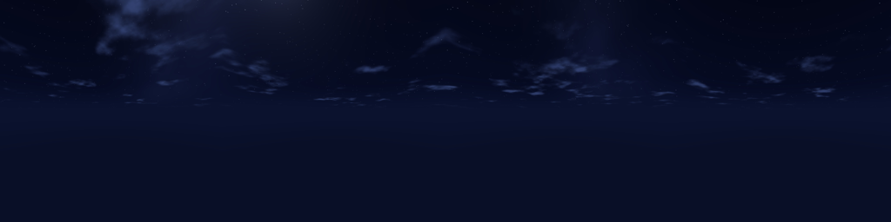

# Bloxd Shaders & Skyboxes

Shaders (WGSL) et skyboxes pour **Bloxd.io**, par **Cyborg_Luca**.
*Shaders (WGSL) and skyboxes for Bloxd.io, by Cyborg_Luca.*

Cinq ambiances, chacune avec un shader et une skybox assortie :

| Ambiance | Shader | Skybox | Aperçu de l'horizon |
|---|---|---|---|
| **Day** – jour lumineux | `shaders/Day` | `skyboxes/Day` |  |
| **Morning** – matin frais, rose-pêche | `shaders/Morning` | `skyboxes/Morning` |  |
| **Sunrise** – lever de soleil doré | `shaders/Sunrise` | `skyboxes/Sunrise` |  |
| **Sunset** – coucher de soleil orange | `shaders/Sunset` | `skyboxes/Sunset` |  |
| **Night** – nuit au clair de lune | `shaders/Night` | `skyboxes/Night` |  |
| **Cycle** – les 5 ambiances en un seul shader | `shaders/Cycle` | (aucune, voir plus bas) | |

## Contenu

```
shaders/<Ambiance>/
    pack.json          (apiVersion 2)
    <ambiance>.wgsl
skyboxes/<Ambiance>/skyBoxes/default/
    px.jpg nx.jpg py.jpg ny.jpg pz.jpg nz.jpg     (1024x1024)
previews/              aperçus de l'horizon de chaque skybox
tools/make_sky.py      script qui génère les skyboxes
```

## Shaders

- Format : API shader Bloxd **version 2** (`apiVersion: 2`), écrits en WGSL.
- Ils modifient le terrain (`bloxdTerrainLight`) et l'eau (`bloxdLiquidSurface`, `bloxdLiquidLight`).
- Chaque shader a sa direction et sa couleur de soleil (`SUN_RAW`, `SUN_COLOUR`), sa couleur de brouillard et son ombrage.
- Un shader ne peut pas dessiner le ciel : l'API n'a pas de fonction pour ça. C'est pour ça qu'il y a des skyboxes à part.

## Shader Cycle (tout en un)

`shaders/Cycle/cycle.wgsl` enchaîne Night → Sunrise → Morning → Day → Sunset → Night en fondu, d'après `bloxdTime()`.

- `CYCLE_SECONDS` : durée d'un cycle complet (doit diviser 3600 : 600, 900, 1200, 1800, 3600).
- `START_LOOK` : ambiance au démarrage (0 Night, 1 Sunrise, 2 Morning, 3 Day, 4 Sunset).
- `HOLD` : durée de chaque ambiance avant de passer à la suivante.
- `USE_GAME_SUN` : `true` par défaut, le shader suit le vrai soleil du jeu (`bloxdSunDirection()`) et reste synchro avec l'heure. Sans soleil dans le monde, il retombe sur l'horloge.
- `SUN_EAST` : direction de l'est. Si le matin ressemble au soir dans le jeu, essaie `vec3f(1,0,0)`, `vec3f(0,0,1)` ou `vec3f(0,0,-1)`.
- `A_SUNRISE`, `A_MORNING`, `A_DAY`, `A_DAY_END`, `A_SUNSET` : angles qui règlent à quel moment de la journée chaque ambiance arrive (petit = plus tôt).
- Le shader ne change que le terrain et l'eau. Une skybox est fixe : elle ne change pas avec le cycle.

## Skyboxes

- Format Bloxd : six faces `.jpg` dans `skyBoxes/<nom>/` (`px`, `nx`, `py`, `ny`, `pz`, `nz`), comme dans [bloxdy/texture-packs](https://github.com/bloxdy/texture-packs).
- L'orientation des faces a été vérifiée sur la skybox par défaut du jeu (raccord des bords entre les faces).
- Chaque skybox reprend les couleurs et la direction du soleil (ou de la lune pour Night) de son shader.
- Le soleil est fixe dans l'image : il ne suit pas le temps du jeu.
- Les images sont générées par `tools/make_sky.py` (Python, `numpy` et `Pillow`) :

```bash
pip install numpy pillow
python tools/make_sky.py sortie            # les 5 skyboxes
python tools/make_sky.py sortie Sunrise    # une seule
```

## Installation

> À compléter : comment charger un pack de shader et une skybox dans Bloxd.

## Crédits

- Shaders et skyboxes : Cyborg_Luca
- Documentation de l'API shader : [GlitchHunterCoder/Bloxd-Essay](https://github.com/GlitchHunterCoder/Bloxd-Essay/tree/main/Shader)
- Format des packs de textures : [bloxdy/texture-packs](https://github.com/bloxdy/texture-packs)

## Licence

MIT, voir [LICENSE](LICENSE).
